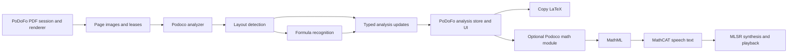

# Podoco architecture and API v0

**Status: proposed implementation contract, 2026-10-25.** This document records
the agreed architecture and proposed interfaces. M1 now implements the
[Rust data/ownership contracts and offline bundles](../podoco/docs/contracts.md).
M2 implements the blocking [Rust layout session](../podoco/docs/layout.md).
M3 implements [Rust document jobs](../podoco/docs/jobs.md); the Rust analyzer
example below now matches that API. M4 implements the
[C/Dart SDK](../podoco/bindings/dart/README.md). M6–M8 implement progressive formula
recognition, optional math conversion, and qualified renderer leases. M9 connects
experimental app Copy/Listen. Queued explicit-crop recognition is now available
across Rust/C/Dart through the same analyzer lane; see the
[crop API](../podoco/docs/formula.md#queued-explicit-crops). The blocking Rust
`FormulaSession` remains available for callers that own their scheduling.
See the [current architecture](../podoco/docs/internal/architecture.md)
and [Core ML qualification boundary](../podoco/docs/coreml.md).

The first complete pipeline analyzes a document's pages, detects layout, and
recognizes **all detected inline and displayed formulas**. It publishes layout
and individual formula results as they become available. Detection can miss
formulas; “all” describes which detections are processed, not guaranteed recall.
PoDoFo can copy recognized LaTeX immediately and ask the optional math module for
speech text to submit to MLSR. PP-DocLayoutV3 is the selected layout model;
PP-FormulaNet_plus-L is selected for formula recognition; its deployed-model
parity is qualified, with [measured accuracy limitations](../podoco/docs/internal/m6-document-validation.md).
The [implementation plan](podoco-implementation.md) sequences the work around
the selected models and explicit qualification gates.

## 1. Ownership and dependency direction



| Layer | Owns |
| --- | --- |
| PoDoFo | PDF documents and leases, rendering, document revisions, persistent result storage, selection, clipboard, and playback orchestration |
| Podoco domain API | Validated inputs, analysis identity, jobs, scheduling, cancellation, results, and errors |
| Model pipelines | Preprocessing, layout decoding, crop selection, formula decoding, and model-specific limits |
| Runtime adapters | Persistent model sessions, native tensors, compute policy, buffer reuse, and backend diagnostics |
| Optional math module | LaTeX-to-MathML conversion, MathCAT configuration, and speech-text generation |
| C/Dart bindings | Ownership translation, input/result transport, and callback delivery |
| MLSR | Voice selection, audio synthesis, playback, and its own speech lifecycle |

Podoco accepts images without depending on pdfrx, Flutter, MLSR, or a PDF parser.
The PoDoFo renderer adapter belongs in the application integration layer. The
Dart binding transports requests and results; it must not implement another
analysis scheduler or recognition pipeline.

Keep pipelines, domain types, runtime adapters, and math support as modules in
the existing Rust core initially. Use a `math` feature for optional conversion
dependencies. Extract crates only when an actual dependency or reuse boundary
justifies it. Isolate necessary unsafe native operations behind reviewed
internal modules; domain logic remains safe Rust. No public API exposes cidre,
Core ML, QNN, or native tensor types.

Initial exclusions are general OCR, table-content extraction, PDF parsing,
automatic document downloading, prose/equation narration assembly, and
subexpression-to-image alignment. Layout regions such as tables still appear in
analysis results without implying that their contents have been extracted.

## 2. Public interface

### Objects and operations

Rust uses snake_case method names; Dart uses camelCase. The names in this document
are proposed v0 names, to be checked together when implementing the interfaces.

| Interface | Contract |
| --- | --- |
| `ModelBundle.verify` | Verify an existing local bundle against its pinned YAML manifest, including hashes and pipeline compatibility. No implicit download or conversion. |
| `Analyzer.open` | Load the configured pipeline models with explicit execution/resource options; return when ready or an owned typed error. |
| `Analyzer.capabilities` | Report the loaded pipeline's supported operations and execution policy, separately from device-execution measurements. |
| `Analyzer.analyzeDocument` | Snapshot options, accept a page source and required update sink, return an eager `AnalysisJob`, and start its pumps. |
| `Analyzer.analyzePage` | Use the same pipeline and update contract for one page. `FormulaScope.none` provides layout-only analysis. |
| `Analyzer.recognizeFormula` | Recognize an explicitly supplied image crop without running detection; require its page/region identity and geometry. Use the same scheduler/ownership rules; return a cancellable `FormulaJob` with the same `FormulaOutcome` inside its authoritative completion. |
| `AnalysisJob` | Expose immutable identity, progress snapshots, cancellation, a final outcome, and idempotent disposal. |
| `MathProcessor.open` | Open verified converter/rule assets independently of an analyzer or ML model. |
| `MathProcessor.toMathml` / `toSpeech` | Convert an expression, or return plain speech text plus conversion provenance. |

`AnalyzerOptions` specifies execution policy and finite resource limits.
`AnalysisOptions` snapshots formula scope (`all` by default, or `none` for
layout-only), the selected qualified preprocessing/decoding profile, and any
explicit profile overrides. First-pipeline recognition covers both inline and
displayed formulas; profiles do not silently discard inline detections.

An analyzer may load a layout-only bundle, but requesting recognition from it
fails with `UnsupportedCapability` before rendering begins. Formula-only work
likewise requires a recognizer. Capabilities describe configured functionality,
not a catalog entry or the existence of downloaded files.

Rust construction and `wait`/`close` operations may block and belong off UI or
async-executor threads. Its page source and update sink run on SDK-managed
delivery/source workers with owned values and `Send + 'static` bounds. Do not
require a particular async runtime in the Rust API. Dart exposes `Future`-based
opening/disposal and invokes application callbacks on the originating isolate;
native inference and blocking waits run off that isolate.

### Page source

`PageSource` describes an immutable document reference and an ordered list of
page descriptors, then renders pages lazily. Descriptors contain the zero-based
page index and logical page size; they contain no raster data. This supports a
whole PDF, an explicit page subset, or a collection of scan images. Duplicate
page indices within a job are rejected.

The source's `loadPage` receives the page descriptor, qualified raster
requirements, an input byte budget, and a cancellation token. It returns a
`PageInput` containing the corresponding `PageImage` and mapping, or a page
error. The SDK requests a page only after reserving capacity. PoDoFo implements
the source using its document lease and asynchronous renderer. The caller must
not eagerly render the entire document inside the source constructor.

The source retains responsibility for a buffer until input acceptance. If a
render finishes after cancellation or input rejection, the binding/source pump
releases the unaccepted image rather than submitting it to a closed job. The
document lease covers the render operation independently of the analysis image
lease. A source revision change terminates that job as `SourceChanged`; inputs
from different revisions must never be combined under one document reference.

### Dart orchestration and optional math usage

The document orchestration and optional math boundary are implemented. `PageSource`,
the persistent store callback, qualified options, and existing MLSR `Tts` are
supplied by the application. They do not hide a PDF parser or a selected model.

```dart
import 'dart:async';

import 'package:flutter/services.dart';
import 'package:mlsr/mlsr.dart' as mlsr;
import 'package:podoco/podoco.dart';

Future<AnalysisOutcome> analyzeDocument({
  required String bundleDirectory,
  required AnalyzerOptions analyzerOptions,
  required AnalysisOptions analysisOptions,
  required PageSource pages,
  required Future<void> Function(AnalysisUpdate) persistUpdate,
  required Stream<void> cancelRequests,
}) async {
  final bundle = await ModelBundle.verify(bundleDirectory);
  final analyzer = await Analyzer.open(bundle, options: analyzerOptions);
  try {
    final job = analyzer.analyzeDocument(
      pages: pages,
      options: analysisOptions,
      onUpdate: persistUpdate,
    );
    final cancellation = cancelRequests.listen((_) => job.cancel());
    try {
      // Progress observation is optional; the update pump already runs.
      return await job.done;
    } finally {
      await cancellation.cancel();
      await job.dispose();
    }
  } finally {
    await analyzer.dispose();
  }
}

Future<void> copyEquation(RecognizedFormula formula) =>
    Clipboard.setData(ClipboardData(text: formula.latex));

Future<mlsr.Speech> listenToEquation({
  required RecognizedFormula formula,
  required MathProcessor math,
  required MathSpeechOptions options,
  required mlsr.Tts tts,
}) async {
  final speech = await math.toSpeech(
    MathInput.latex(formula.latex, displayKind: formula.displayKind),
    options,
  );
  // The caller configures MLSR's voice/locale and owns the returned Speech.
  return tts.speak(speech.text);
}
```

For repeated documents, keep the analyzer and math processor open at the
application-service level; the helper above deliberately demonstrates complete
resource cleanup. `RecognizedFormula` is the successful outcome payload, so
Copy/Listen do not accidentally accept failed or truncated recognition.

### Rust document usage

The Rust facade has the same source, update, cancellation, and outcome semantics.
The sink returns after accepting an owned update; a blocking persistence call
there applies backpressure. `AnalysisJob::cancellation` returns a lightweight
cloneable cancellation handle, not a reference to native model objects.

```rust
use std::{path::Path, sync::mpsc};

use podoco::{
    AnalysisOptions, AnalysisOutcome, AnalysisUpdate, Analyzer, AnalyzerOptions,
    CancellationHandle, ModelBundle, PageSource, Result,
};

pub fn analyze_document<S, F>(
    bundle_directory: &Path,
    analyzer_options: AnalyzerOptions,
    analysis_options: AnalysisOptions,
    pages: S,
    persist_update: F,
    cancellation_owner: mpsc::Sender<CancellationHandle>,
) -> Result<AnalysisOutcome>
where
    S: PageSource + Send + 'static,
    F: FnMut(AnalysisUpdate) -> Result<()> + Send + 'static,
{
    let bundle = ModelBundle::verify(bundle_directory)?;
    let analyzer = Analyzer::open(bundle, analyzer_options)?;
    let work: Result<AnalysisOutcome> = (|| {
        let job = analyzer.analyze_document(pages, analysis_options, persist_update)?;
        // The application can retain this handle and call cancel() from another thread.
        if cancellation_owner.send(job.cancellation()).is_err() {
            job.cancel();
        }
        let outcome = job.wait();
        let closed = job.close();
        let outcome = outcome?;
        closed?;
        Ok(outcome)
    })();
    let closed = analyzer.close();
    let outcome = work?;
    closed?;
    Ok(outcome)
}
```

The optional math feature supplies the same independent conversion boundary to
Rust callers. The caller writes the clipboard string through its platform API
and submits the speech string to its existing MLSR controller.

```rust
use podoco::{
    math::{MathInput, MathProcessor, MathSpeechOptions},
    results::RecognizedFormula,
    Result,
};

pub fn equation_for_clipboard(formula: &RecognizedFormula) -> String {
    formula.latex.clone()
}

pub fn equation_for_tts(
    math: &MathProcessor,
    formula: &RecognizedFormula,
    options: MathSpeechOptions,
) -> Result<String> {
    let speech = math.to_speech(MathInput::latex(&formula.latex, formula.display_kind), options)?;
    Ok(speech.text)
}
```

The document-job facade is implemented; the complete
[PNG document example](../podoco/crates/podoco/examples/document_layout.rs) is
compiled by the development checks. The [Dart document example](../podoco/bindings/dart/example/document_layout.dart)
is also analyzed and exercised with real model assets. See the compiled
[math example](../podoco/crates/podoco/examples/math.rs) and the
[optional math SDK](../podoco/docs/math.md) for explicit rule preparation and ownership.

## 3. Images, coordinate systems, and ownership

### Image and page descriptors

| Value | Required meaning |
| --- | --- |
| `DocumentRef` | Application-defined document identity and immutable revision; not a filesystem path |
| `PageKey` | Document reference plus zero-based page index; pdfrx's one-based index is converted at the adapter boundary |
| `PageSpace` | Positive finite width/height in caller-defined logical page units; PDF inputs use points in displayed page orientation |
| `PageImage` | Width/height in pixels, BGRA8 or RGBA8, positive byte row stride, alpha interpretation, backing storage length and ownership |
| `pixelToPage` | Finite, invertible affine transform from pixel-edge coordinates into canonical page space |
| `PageInput` | Page identity/space, image, transform, and rendering-profile identity |

Canonical page coordinates start at the top left, with X rightward and Y
downward. Image rows are top-to-bottom; negative strides are not accepted in v0.
Pixel-edge coordinates span `[0, width]` and `[0, height]`; region bounds describe
continuous extents. Integer crop conversion uses floor for minimum edges, ceil
for maximum edges, and clamps to the valid raster, rejecting an empty crop.

For an uncropped page render, `pixelToPage` normally scales image extents to
logical page extents. Cropped renders add translation; rotated renders require
the corresponding mapping. `PdfRect` uses bottom-left coordinates, so the
PoDoFo adapter must explicitly convert instead of passing those fields through
unchanged. Test all four corners through rotation and crop transforms.

Report geometry only in canonical page space and carry the input mapping in
page provenance. A region has required axis-aligned bounds and an optional
polygon when supported by the adapter. Dense model masks remain internal by
default. A request that requires unsupported geometry/order returns an explicit
capability error; an optional result is absent rather than synthesized.

Validate dimensions, stride, and storage spans with checked arithmetic. For
four-byte pixels, a strided view must cover at least
`(height - 1) * rowStride + width * 4` bytes. Account for the full retained
allocation against the input budget, including padding. Reject non-finite or
singular transforms and invalid page identity before accepting the input.

Alpha is explicitly opaque, straight, or premultiplied; preprocessing follows
the selected interpretation and composites onto the profile's background.
PoDoFo's initial analysis rendering uses an opaque white background and excludes
annotations/forms via pdfrx's `none` rendering mode. This avoids highlighted
page overlays changing recognition input; form-field analysis is outside that
initial rendering profile. Rendering policy is part of result/cache provenance.

### Safe copying and native leases

| Input path | Ownership contract |
| --- | --- |
| `PageImage.copy` | Copy caller bytes into immutable SDK-owned storage before returning; the caller can immediately reuse its source. |
| Native lease import | The interop adapter proves allocation lifetime and exclusive write exclusion, supplies its release mechanism, and retains the allocation until all native reads end. |

The native import is an advanced unsafe boundary in Rust/C, wrapped by a narrow
application adapter in Dart. A typed list or raw integer address alone is not
an owner. No writable image view may survive submission. On acceptance, the SDK
owns the submitted image handle/lease; on rejection, ownership stays with the
submitter, including for a full input queue. Low-level submission makes that
distinction explicit. Public facades wait for capacity and clean up rejected
images for their source.

The lifetime is:

```text
source owns image -> accepted immutable lease -> native reads finish
                 -> release acknowledged -> source allocation may be freed
```

The SDK releases exactly once on success, page failure, cancellation, or worker
failure. Requesting cancellation, dropping the last UI reference, or receiving
layout results does not imply that reads have finished. The initial pipeline
may retain a page image until its formula work finishes; it does not retain the
document's entire raster set. Result objects own their strings/geometry and do
not borrow the input image.

Inspection of pdfrx_engine 0.6.1 shows a native BGRA allocation exposed as a
`Uint8List` view, with its pointer private and freed by `PdfImage.dispose()`.
The first integration therefore needs a supported native lease extension or
adapter in that renderer dependency. Keep that integration out of generic
Podoco and do not modify the pub cache. Until the adapter is qualified,
`PageImage.copy` is the supported path. Dart's `.address` shortcut is restricted
to leaf native calls and does not provide an asynchronous retention contract.
[Dart typed-data address documentation](https://api.dart.dev/dart-ffi/Uint8ListAddress/address.html)

“Zero-copy input” means no extra full-image pixel copy between the renderer and
Podoco. It does not promise zero-copy preprocessing or device execution. The
pipeline may resize, composite, change channel order, create tensors, or incur
backend transfers. Measure and report those boundaries separately. Recognition
crops use the original qualified-resolution raster, not the detector's
downsampled tensor. Numeric raster recommendations are model-qualification
outputs, not universal API constants.

## 4. Pipeline results and progressive delivery

The native pipeline performs layout preprocessing/inference/decoding, emits
layout, then recognizes each detected formula using its image crop. Inline
formula regions may be nested inside paragraph regions. Do not remove valid
overlap using generic cross-category deduplication. Equation-number regions
remain distinct from formula content; only qualified model-specific rules may
associate or separate them.

Each `AnalysisUpdate` contains a result-schema version, analysis ID, document
reference, monotonically increasing sequence number, and typed payload.
Page-scoped payloads include a `PageKey`. Caches serialize this portable domain
data, not native handles. Sequence numbers order one job's updates; they are
not cross-job timestamps.

| Update | Payload and guarantee |
| --- | --- |
| `PageLayoutReady` | Immutable regions, stable region IDs, page provenance, and optional model-supported reading order |
| `FormulaFinished` | Region ID and one terminal recognition outcome; its layout region has already been delivered |
| `PageFinished` | Immutable final `PageAnalysis`, including every region's final formula status, diagnostics, and counts |
| `PageFailed` | Page key and owned error for a page that cannot produce a usable layout result |
| `DocumentFinished` | Processing summary and counts; no accumulated document raster/result graph. The job's final outcome also accounts for delivery success. |

Deliver pages in source order initially and formulas in their stable region
order. Layout precedes formula results, and final page snapshots agree with the
preceding updates. Region IDs remain stable within one page analysis. They are
not guaranteed to identify the same object after rerunning another model or
revision. Retry jobs have new analysis IDs; replacing an old result is an
explicit application-store operation.

`LayoutRegion` contains normalized category, original model label/class ID,
bounds, optional polygon, optional detection score, and diagnostics. Keep
unrecognized categories as `other` with their original labels. Formula display
kind is `inline`, `displayed`, or `unknown`; do not infer it from arbitrary box
size. `FormulaScope.all` processes unknown-kind formula detections too. Reading
order carries its model/adapter provenance; region enumeration is not a promise
of prose reading order.

`FormulaOutcome` distinguishes `recognized`, `failed`, and `truncated`.
`RecognizedFormula` preserves the recognizer's LaTeX without app-side rewrites,
its display kind, optional recognition score, and recognition provenance.
The adapter's token decoding rules are part of that provenance. Scores are not
interchangeable probabilities across models. A token-limit hit may retain
partial LaTeX for diagnostics but is not a successful `RecognizedFormula`.
Layout-only results explicitly mark recognition as not requested.

Provenance records model/bundle hashes, adapter and preprocessing/decoding profile
versions, render profile, SDK version, effective backend/policy, and relevant
options. A requested Neural Engine policy is not evidence of actual placement.
Timing and placement observations are separately labelled diagnostics.

The initial error policy is best effort for page/formula failures. Continue to
later pages, preserving successful data. A final `AnalysisOutcome` is one of
`completed`, `partial`, `cancelled`, or `failed`, with page/formula counts and
diagnostics. `partial` means all requested work was attempted but some page or
formula outcomes failed/truncated. Fatal backend, source-revision, or delivery
failure terminates the job. Cancellation leaves already delivered data valid,
with unfinished pages visibly incomplete.

## 5. Scheduling, cancellation, and disposal

Use one inference lane per analyzer, persistent models, and bounded FIFO job
scheduling initially. An active job has at most one processing page and one
prefetched page, further limited by byte capacity. A queued job does not start
rendering. Input, result, tensor, and decoder-cache allocations have explicit
finite limits. Refuse a request that cannot fit rather than silently shrinking
its quality settings. Large individual updates also have a byte limit; count
limits alone do not bound memory. Profile defaults are set during qualification.

Preprocessing/cropping and decoder output handling reuse allocations where
correct. Core ML wrappers live on their owning worker and are not made
`Send`/`Sync` with unsafe assertions. Handle autorelease pools, exceptions, and
owned errors at the native boundary. Respect output tensor strides instead of
assuming contiguous memory. Future QNN adapters implement these same domain
contracts, with availability reported explicitly. Retain the
[cidre coexistence policy and checks](../podoco/docs/coreml.md).

`analyzeDocument` starts internal source and result pumps immediately after
acceptance. `onUpdate` is required, invoked serially, outside native locks.
Awaiting its returned future acknowledges that update and permits more delivery.
Progress observation is optional, coalesced, and independent of result
consumption. Watching progress neither consumes nor duplicates result updates.

Distinguish processing counts from acknowledged-delivery counts. In particular,
cancellation may discard a computed but undelivered result. `DocumentFinished`
summarizes processing; it cannot guarantee that its own sink call will succeed.
The application uses `done`/`wait` for the authoritative job outcome, including
a failure while persisting that terminal notice.

On normal completion, `done`/`wait` resolves after all updates, including the
terminal notice, have been acknowledged and native work/input leases have
drained. A job's final outcome is immutable. Request validation/opening failures
are returned before a job exists; processing failures are represented by its
outcome and owned diagnostics.

`cancel` is nonblocking and idempotent. It stops further page requests, cancels
queued work, and requests cancellation of active source operations. The native
worker checks cancellation between predictions and autoregressive decoding
steps. An already running native prediction finishes before its inputs can be
released. Undelivered content updates may be discarded on cancellation; earlier
delivered results remain owned and valid. A terminal notice is delivered if the
sink is healthy. On sink failure, `done` is the authoritative terminal channel
and reports `DeliveryFailed`; do not recursively send errors into the failed sink.

Control traffic for cancellation, buffer-release acknowledgements, and shutdown
must not wait for room in the result queue or an application sink acknowledgement.
The binding keeps its control pump alive while awaiting an async sink. Native
readers can drain and image leases can be released while storage delivery is
slow. No control acknowledgement is represented as an application analysis update.

`dispose`/`close` cancels unfinished owned jobs, drains native work and release
acknowledgements, waits for active application callbacks/source calls to finish,
then tears down callback registrations and workers. It is idempotent. The SDK
cannot interrupt arbitrary caller code: source/sink implementations must honor
cancellation and finish their calls. A never-resolving caller future can delay
facade completion/disposal, but cannot prevent the native control path from
releasing buffers it has stopped reading. A sink must not await its own job's
`done` or `dispose`, nor synchronously wait for another job queued behind it.

These rules prevent use-after-free; they do not promise a fixed cancellation
latency. Record native drain time separately from application callback time.

## 6. C ABI and Dart transport

Keep native library compatibility separate from result-schema compatibility.
The existing identity ABI remains intact. New entry points require an explicit
ABI review, coordinated header/binding generation, and capability/version
negotiation before use; an old identity-only library must fail opening the new
API cleanly. Breaking ABI changes increment the ABI version.

Use opaque analyzer, job, image, and result handles. The C surface has explicit
operations for creation, source replies/input submission, result polling and
acknowledgement, cancellation, and release. Low-level pending-source requests
carry opaque request tokens; Dart maps those requests to `PageSource.loadPage`
and replies asynchronously. Rust owns admission and scheduling. No Rust worker
synchronously calls Dart for an image, and no Dart scheduler chooses pipeline
stages. Avoid generic operation-name dispatch or exposing Rust struct layout.

Images cross through fixed-width native buffer descriptors with explicit
length/stride/format and lease ownership. All pointer imports are caller safety
contracts; validating lengths does not prove that an arbitrary pointer is
readable. Copying constructors remain available without unsafe caller ownership.

Semantic updates use owned, length-delimited UTF-8 JSON with a schema version,
bounded payload size, and finite numeric values. Rust domain types define the
schema; Dart decodes it into typed immutable classes. Strings, geometry, and
metadata may be copied across this boundary. Pixel buffers, masks, and tensors
are never encoded as JSON/base64. An opaque result handle owns its payload until
explicit release. The Dart adapter copies/decodes before releasing that handle
or invoking application code; callers can retain the resulting values safely.

Finalize the v0 field schema and fixtures during the API implementation
milestone. Additive optional fields can be ignored by older decoders; new
required behavior or variants require negotiated support or a schema-version
change. Unsupported versions must fail explicitly. Public Rust enums and Dart
sealed types mirror the same outcomes; no binding fabricates a successful
fallback for an unknown required variant.

Cross-thread wakeups may use `NativeCallable.listener`, carrying only scalar
tokens that cause the Dart control/result pumps to drain owned native queues.
Do not place temporary pointers in such notifications. Dart documents deferred
delivery and forbids invoking a callable after it is closed; shutdown must stop
native producers and account for pending notifications before closing it.
[Dart callback lifetime documentation](https://api.dart.dev/dart-ffi/NativeCallable/NativeCallable.listener.html)

Every fallible C entry point returns a status plus an owned error/handle as
appropriate. Panics and native exceptions must not unwind through the C ABI.
Finalizers are a leak backstop, not the primary lifecycle; normal application
flows explicitly dispose jobs/analyzers and release accepted image leases.

## 7. Optional math conversion

`MathProcessor` accepts `MathInput.latex` and `MathInput.mathml` with display
context. `toMathml` returns the converted expression and diagnostics;
`toSpeech` returns plain text, effective language/style, MathML, and converter,
MathCAT, and rule-asset provenance. It does not synthesize audio or depend on
MLSR. Speech is generated on demand, so changing a locale or speech style never
reruns recognition.

The math processor owns its worker and queued conversion requests. Its
idempotent `dispose`/`close` cancels queued requests and drains an active
conversion before releasing state, without closing an analyzer or MLSR session.

For an unknown formula display kind, conversion uses inline MathML display
semantics and records that effective choice. The recognition result remains
`unknown`; this conversion default is not evidence that the equation was inline.

The conversion path is LaTeX -> MathML -> MathCAT -> plain speech text. MathCAT
requires rules/preferences and accepts MathML through its expression API.
Its numeric separator settings are distinct from the spoken language.
[MathCAT caller documentation](https://daisy.github.io/MathCAT/callers.html)

Use a dedicated worker per math-processor instance. Apply a complete supported
preference snapshot, set the expression, and extract output as one serialized
operation, without interleaving another expression or locale. Use plain-text
output (`TTS=None`). Require explicit language/style options and validate them
against the installed rules; unsupported choices return typed errors rather
than silently selecting another language. Record the effective numeric-locale
settings when the caller supplies them, otherwise the selected profile defaults.

Preserve recognized LaTeX on conversion errors. Unsupported commands, malformed
MathML, missing rules, and resource-limit failures are conversion outcomes;
they do not invalidate successful recognition or Copy. Do not silently rewrite
unknown commands or send raw LaTeX to MLSR as if conversion succeeded. MathML
canonicalization is a derived representation, not a replacement for copied LaTeX.

Converter choice and exact MathCAT version/rules are qualification gates.
Check coverage of actual recognizer output, syntax/nesting/expansion limits,
licenses, deployment, MSRV, rule loading, and state isolation. Upstream MathCAT
currently uses thread-local expression state and its initialization installs a
panic hook; a pinned integration must audit that host-visible behavior instead
of assuming a worker isolates process-global effects.
[MathCAT interface source, inspected 2026-10-25](https://github.com/daisy/MathCAT/blob/main/src/interface.rs)

Rules and converter versions are pinned with hashes in asset provenance, using
the existing [model-manifest policy](../podoco/model-manifests/README.md) where
applicable. Normal library builds/opening do not download models or rules.
Preserve Rust 1.88 support unless a separately reviewed dependency decision
changes it. No dependency version is selected by this design document alone.

## 8. PoDoFo storage and user flows

PoDoFo's analysis store consumes updates and owns persistent results. Podoco
retains only bounded active work and delivery payloads. Store results under the
document/input identity, page, render policy, pipeline/model/profile versions,
and effective options/backend variant. Cache an authoritative final page
snapshot separately from incomplete progressive work. Never treat an empty or
partially delivered page as fully analyzed.

Before applying an update, verify its document revision and active analysis ID.
For asynchronous persistence, repeat that check at commit time. Closing a tab
or replacing the document cancels the job and invalidates its active store
generation. A late result cannot repopulate the newly opened document. Use the
existing session revision conservatively initially; reusing analysis across
annotation-only revisions requires a proven content/render identity, not a path
or the assumption that every edit is irrelevant.

The store applies `FormulaFinished` to its existing layout region, enabling Copy
and Listen before the document finishes. `PageFinished` provides the final
snapshot for reconciliation and persistence; sequence numbers prevent duplicate
application within one analysis. SDK acknowledgement means the application
accepted an update, not necessarily that a disk transaction is durable; the
application decides when its sink future completes.

For Copy, use successful `RecognizedFormula.latex` without re-running detection
or conversion. For Listen, call the math processor with the selected expression
and locale/style, then submit returned text to the existing MLSR narrator or
`Tts`. PoDoFo owns the returned speech handle and playback controls. Cache speech
text by expression, conversion/rule versions, and math preferences; do not key
it only by the image region or an MLSR voice ID.

Highlight the whole equation region initially. MathCAT node IDs identify its
MathML tree, not pixel locations inside the original image. Integrated prose
and equation narration additionally needs verified reading order, native-text
source mapping, and a rule for replacing overlapping extracted math text. Those
are later contracts, not consequences of having recognized LaTeX.

## 9. Validation and implementation gates

The following are required acceptance cases, not a claim of passing tests for
unimplemented APIs.

| Area | Acceptance cases |
| --- | --- |
| Image validation | BGRA/RGBA, padded rows, alpha modes, empty/overflowing dimensions, undersized storage, invalid transforms, and byte-budget rejection |
| Geometry | All four page rotations, cropped/high-resolution renders, non-square detector resizing, corner/box round trips into pdfrx coordinates, and nested inline math |
| Ownership | Equal copied/leased predictions; exactly-once release after success, rejection, full queue, worker error, cancellation, and disposal; source render completing after cancellation |
| Scheduling | Long documents with bounded raster/tensor/result memory, slow sinks, full queues, missing progress listeners, early `done` awaiting, and cancellation under every wait state |
| Delivery | Layout before formula outcomes, stable region references, duplicate-update handling, consistent final snapshots, explicit failed/truncated formulas, and sink failure |
| Lifecycle | Repeated disposal, callback/source cancellation cooperation, no post-close native callback, and buffer release independent of a stalled sink |
| Application | Closing/editing/reopening during analysis, revision checks at persistence commit, cancellation with useful partial results, and cache invalidation for changed model/render profiles |
| Math | Recognized LaTeX preserved; malformed/unsupported syntax, token limits, MathML conversion fixtures, missing rules, explicit locales/styles, alternating-instance isolation, and plain speech text |
| Bindings | Rust/C/Dart outcome parity, Unicode/length-delimited payloads, schema/ABI mismatch, unknown optional fields, bounded decoding, and old native-library rejection |
| Runtime | Real-model reference parity, noncontiguous outputs, model/buffer reuse, error recovery, requested versus observed device policy, and same-process loading with MLSR |

Separate model-quality evidence from architectural tests. Evaluate detector
recall/precision for inline and displayed math, recognition quality on real
crops, malformed/truncated output rates, and conversion/speech readability.
Test the complete path as well as the individual models. Report cold opening,
warm page/region latency, cancellation drain, peak memory, and copying boundaries
on pinned inputs/settings. There is no latency or accuracy threshold selected
by this document without a representative qualification corpus.

The gates below describe the architecture-level scope. The
[implementation plan](podoco-implementation.md) splits them into M1–M9, including
a usable layout-only path before the formula model is ready.

| Milestone | Completion gate |
| --- | --- |
| A. Domain API and ownership | Implement proposed types, bounded jobs, source/sink transport, copy/lease contracts, generated C/Dart bindings, and deterministic fake-pipeline lifecycle tests. Replace proposed examples with type-checked examples. This does not establish model quality. |
| B. Model and profile qualification | Select/pin layout and formula models; record licenses, artifacts, reference outputs, preprocessing/decoding contracts, raster/token/resource profiles, deployment floors, and measured acceptance thresholds. Verify actual Core ML inference through Rust. |
| C. Progressive document pipeline | Connect qualified adapters to A; demonstrate layout and both kinds of formula recognition over real multipage inputs, bounded memory, partial failures, cancellation, and authoritative final page results. |
| D. Optional math module | Qualify/pin converter, MathCAT, and rule assets; pass syntax, state-isolation, error, and speech-text fixtures; preserve Copy when Listen conversion fails. It can proceed independently of B/C. |
| E. PoDoFo integration | Integrate the page source/store and renderer lease extension, verify geometry/revision safety, and exercise Copy/Listen through actual MLSR playback. Publish separate correctness, memory/copy, and performance evidence. |

PP-DocLayoutV3 is the selected layout model. Its local Core ML/ANE prototype is
an integration baseline, not yet a qualified Podoco bundle or formula recognizer.
Its evidence is in the sibling `docling-layout-heron-coreml` repository under
`results/ppdoclayoutv3-coreml-20261025/REPORT.md`; keep the pinned report/artifact
provenance when promoting a model. Heron experience also demonstrates why output
stride handling and detection-versus-recognition qualification must stay explicit.
PP-FormulaNet_plus-L is selected for recognition. Its native artifacts, decoder
contract, and measured limits still require qualification; selection alone does
not establish a runnable deployment.

### Decision record

Agreed defaults: analyze all pages supplied by the caller, recognize inline and
displayed formulas, publish progressive updates, require an update sink, keep
long-lived storage in PoDoFo, offer native leases plus a safe copying fallback,
and keep math conversion optional inside Podoco. Core ML on macOS is first;
Qualcomm Windows QNN follows the same contracts when separately qualified.

Model/converter pins, corpus thresholds, numeric raster/token/memory defaults,
and non-macOS qualification are explicit milestone outputs. Their deferral does
not defer the ownership, coordinates, delivery, cancellation, or error semantics
specified above. None of this documentation freezes a public analysis ABI before
the implementation and compatibility checks exist.
