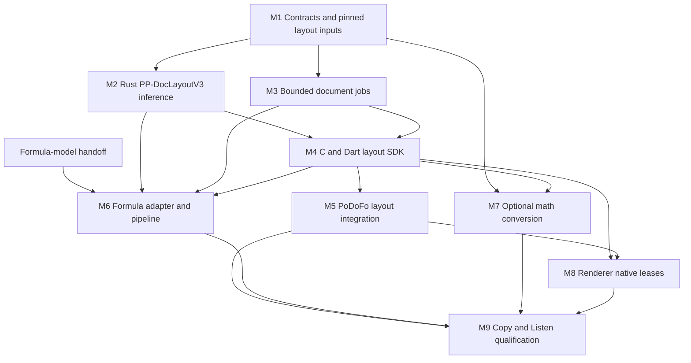

# Podoco implementation plan

**Planning baseline: 2026-10-25, branch `feat/podoco`, commit `5271884`.**
The [API v0 design](podoco-api.md) defines the intended behavior. This plan orders
its implementation into independently reviewable milestones; it is not evidence
that the proposed APIs or models are integrated.

**Implementation update:** M1's Rust contracts, image ownership boundary,
offline bundle tooling, and reference fixtures are implemented. See
[M1 contracts](../podoco/docs/contracts.md) and
[validation evidence](../podoco/docs/internal/m1-validation.md). M2 now adds
[blocking Rust layout inference](../podoco/docs/layout.md); see
[its qualification](../podoco/docs/internal/m2-validation.md). M3–M9 remain
planned; the starting-point inventory below records the original baseline.

PP-DocLayoutV3 is the selected layout model. PP-FormulaNet_plus-L is the selected
formula recognizer (2026-10-26). Its conversion and native qualification remain
M6 work. Model selection, availability of a converted artifact, and qualified
Podoco execution are separate gates.

## Starting point and constraints

- The Rust/C/Dart identity scaffold, generated bindings, and desktop host build
  checks exist. Document analysis, model delivery, and job APIs do not.
- The optional cidre/Core ML dependency has observer exclusion and same-process
  checks with MLSR. Keep that dependency policy and those tests throughout.
- Initial implementation and real-model qualification target macOS arm64 with
  the existing macOS 15 deployment floor. Portable domain/C/Dart checks continue
  on other desktop hosts; configured CI does not establish runtime support.
- Rust owns model execution, analysis scheduling, and result semantics. PoDoFo
  owns rendering and persistent storage. No PDF parser, MLSR dependency, or
  platform tensor types enter Podoco's public core API.
- Start with the safe image-copy path. Implement the native lease contract early
  and qualify the renderer's lease adapter separately; the copying path remains
  supported. Neither path implies zero-copy preprocessing/device execution.
- Keep models and large captured outputs outside Git. Use the existing Python
  environments for reference tooling; normal library builds do not download
  weights or require Python.

Implementation stays within the existing package boundaries. The module names
below are proposed; extract another crate only when a concrete dependency or
reuse requirement justifies it.

| Location | Planned work |
| --- | --- |
| `podoco/crates/podoco/src/` | Safe domain/image/bundle modules; analyzer and job lifecycle; private `pipelines/layout`, `pipelines/formula`, and `runtime/coreml`; optional `math` module |
| `podoco/crates/podoco-ffi/` | Handles, checked foreign buffers, request/reply transport, result ownership, and panic containment |
| `podoco/bindings/dart/` | Typed public API, source/result/control pumps, native assets, and consumer tests |
| `podoco/model-manifests/` and `podoco/tools/` | Pinned YAML profiles, local bundle preparation, reference capture/replay, and qualification reports |
| `podoco/crates/podoco/examples/` | Real page-layout and later formula/document examples using public Rust APIs |
| `podofo_frontend_one/lib/src/` | Application analysis service, renderer adapter, persistence, and Copy/Listen integration with existing narration |

No application rendering or playback dependencies flow back into the Rust core.
Model-specific details remain private behind the domain API; the `coreml` and
`math` features remain independently optional.

The dependency graph is:

M1–M5 can proceed without the formula model. M3's deterministic lifecycle work
can proceed independently of M2. M6 joins when its handoff is ready; M7 can use
known LaTeX fixtures before then. M8 can proceed alongside formula integration.
These are dependency opportunities, not a requirement to run multiple agents
or concurrent performance experiments.

## PP-DocLayoutV3 integration baseline

Use the existing conversion project at `~/GitHub/docling-layout-heron-coreml`
as the evidence source. Its committed prototype is `401bf7e`; the inspected
checkout is `e44f004`. Recognition research is currently uncommitted there;
consume only an explicit handoff snapshot rather than treating evolving files
as a selected model or editing that checkout.

The layout checkpoint is
[`PaddlePaddle/PP-DocLayoutV3_safetensors`](https://huggingface.co/PaddlePaddle/PP-DocLayoutV3_safetensors/tree/e4f489dc536556fc1be02b973ba06756e0d4a2ac),
revision `e4f489dc536556fc1be02b973ba06756e0d4a2ac`. Start from the prototype's
`optimized-mixed.mlpackage` and compiled counterpart, verifying their files
against `results/ppdoclayoutv3-coreml-20261025/manifest.json`. These are integration
baselines, not yet promoted production bundles.
The reference processor is Transformers 5.8.1; retain its exact source/hash in
the fixture manifest rather than using the moving upstream documentation as an
executable specification.

| Boundary | Recorded prototype contract |
| --- | --- |
| Input | RGB Float32 NCHW `[1,3,800,800]`; pinned processor's bicubic resize, division by 255, identity mean/std |
| Class logits | Float32 `[1,300,25]` |
| Boxes | Float32 `[1,300,4]`, normalized CXCYWH |
| Reading order | Float32 `[1,300,300]` |
| Masks | Float32 `[1,300,200,200]`: 48,000,000 bytes per prediction before other allocations |

Port the pinned processor, not just its broad description. Classification uses
sigmoid and top-300 query/class pairs; preserve query identity when gathering
boxes and reading-order ranks. The recorded comparison uses score `>= 0.30`,
while the inspected processor's method default is `0.50`; use an explicitly
versioned `0.30` baseline profile for replay rather than an implicit default.
This is a reproduction setting, not a newly tuned quality recommendation.

Class IDs 5 and 15 are formula classes, while 11 is formula-number. The pinned
checkpoint labels both formula classes with the same string. Preserve class IDs
and pin the native display/inline mapping with its source; do not derive subtype
from that collapsed string or a box-size heuristic. Preserve IDs for other
duplicate label names as well.

Initial SDK output includes boxes, categories, scores, and validated model
reading order. Polygon capability remains unavailable until separately ported
and checked against the processor. The current mask-IoU experiment is not polygon
validation, and its logit-zero mask diagnostic differs from the processor's
score-threshold-based mask handling. The upstream architecture includes both
segmentation and order prediction; qualifying a subset of adapter outputs does
not change the selected model. [Model documentation](https://huggingface.co/docs/transformers/main/en/model_doc/pp_doclayout_v3)

The existing 50-page report records two extra detections relative to eager FP32,
including a high-confidence duplicate heading, and 25 differing matched order
pairs. Preserve those exact cases. Do not hide them with generic NMS or widen
numeric tolerances until the tests pass. Investigate the export/precision behavior
before promoting the mixed-precision profile; unexplained high-confidence
duplicates and non-finite outputs block promotion. A corrected export is a new
artifact/profile requiring reference replay, not a reason to reopen model-family
selection. Conversion agreement and ground-truth layout quality remain separate.

## Milestones

### M1. Domain contracts, image ownership, and pinned layout inputs

**Depends on:** current scaffold. **Formula selection:** not required.

- Implement page/document identities, canonical geometry and transforms, checked
  BGRA/RGBA image descriptors, owned copying, and the internal native lease
  boundary. Preserve safe domain code and isolate necessary unsafe operations.
- Define typed layout/formula outcomes, errors, analysis updates, provenance,
  and resource policies from the API document. Finalize the result-schema v0
  baseline with serialization fixtures; keep detection, recognition, and delivery
  outcomes distinct.
- Add the concrete YAML layout-bundle contract and offline verification/preparation
  tool: revision, hashes, license, tensor/profile contracts, and local asset
  paths. A layout-only bundle advertises no recognizer. Do not emit an empty or
  fabricated recognition result for `FormulaScope.all`.
- Capture a small, redistributable reference set and retain the existing 50-page
  corpus by manifest/hash outside Git. Save raw input tensors, small raw outputs,
  selected mask evidence, and expected decoded layout data with processor/source
  versions. Review fixture licensing before checking images into Git.

**Done when:** portable validation/serialization tests cover overflow, stride,
alpha, rotation/cropping, invalid mappings, ownership rejection, and lease release;
bundle verification rejects missing/tampered/mismatched inputs. Reference tooling
reproduces the pinned baseline without downloading models during ordinary tests.
No inference API is claimed complete at this stage.

### M2. Real PP-DocLayoutV3 inference through Rust

**Depends on:** M1. **Formula selection:** not required.

- Build a private thread-confined Core ML adapter with persistent model loading,
  retained tensors, owned diagnostics, exception boundaries, and stride-aware
  reads. Use MLSR's inspected runtime as a reviewed implementation reference;
  adapt only necessary parts, preserve attribution for copied code, and introduce
  no dependency on the TTS crate or shared-runtime extraction in this milestone.
- Prepare verified local assets for loading, using the verified compiled artifact; M2 performs no implicit compilation
  or download. Keep preparation failures distinct from inference failures and
  record cold preparation separately from warm predictions.
- Implement and verify the exact preprocessing and box/order postprocessing
  against saved Python inputs/outputs. Preserve source query IDs and untied ordering, with the approved v1 query-ID
  tie-break profile; do not assume a generic bicubic resize is equivalent.
- Add a headless Rust page-layout example that emits canonical page-space results
  and provenance. It exercises the real library pipeline, with image decoding
  outside the core's raw-image boundary.
- Retain the current four-output export for baseline parity. Consume only needed
  outputs on the Rust host; never serialize the full mask tensor through FFI.
  Account for native mask allocation even when it is not copied to the host.
  Output pruning, selected-query masks, and quantization are later measured
  optimizations, each requiring new artifact qualification.

**Done when:** real pages run through Rust/cidre, small-fixture parity is explained
at each boundary, retained 50-page replay introduces no unaccounted differences,
and geometry, model reuse, errors, and release checks pass. CPU-only is the
diagnostic control; CPU+ANE/other allowed policies are compared explicitly.
The prototype remains labelled experimental until its promotion issues above
are resolved. This milestone yields a useful layout CLI without waiting for LaTeX.

### M3. Bounded Rust document jobs

**Depends on:** M1; connect M2 when ready. **Formula selection:** not required.

- Implement `Analyzer`, lazy page-source requests, eager job handles with required
  sinks, FIFO scheduling, progress, cancellation, and idempotent close. Reserve
  input capacity before requesting/rendering a page.
- Keep one active page plus at most one prefetched page, bounded by bytes. Bound
  retained updates and per-update size as well as item counts. Separate release,
  cancellation, and shutdown control from backpressured result delivery.
- Implement layout-only progressive results and authoritative page snapshots.
  Use deterministic private fake pipeline stages to test the full formula-event
  lifecycle; never expose a fake recognizer as a runtime capability.
- Define model-independent cancellation/failure behavior now; defer tokenization,
  decoder-cache shapes, and recognition scheduling details to the selected model.

**Done when:** deterministic tests cover slow/failed sinks, full queues, cancellation
at every wait, late rendering, worker errors, partial pages, terminal-notice
delivery failure, and repeated shutdown. Awaiting `done` works without a progress
subscription. Real layout jobs produce the same page results as M2 under bounded
memory; model objects never migrate across native worker threads.

### M4. C ABI and usable Dart layout SDK

**Depends on:** M2 and M3. **Formula selection:** not required.

- Implement opaque handles, explicit image/result ownership, source request/reply
  transport, versioned JSON metadata, and status/error handling. Finalize ABI
  negotiation before generated bindings so an identity-only dylib fails cleanly.
- Build Dart source, result, and control pumps, typed immutable results, required
  async update sinks, progress, cancellation, and disposal. Native callbacks wake
  the pumps with scalar tokens; no temporary pointers cross delayed notifications.
- Expose copied-image input and test the native-lease ABI using a controlled
  allocator. Real renderer leases remain M8.
- Make Core ML an explicit supported Dart native-build option; enforce its macOS
  deployment floor and track vendored dependency inputs in hook invalidation.
  Keep default portable builds and prebuilt-library handling intact.
- Replace applicable proposed examples with type-checked examples and document
  actual capabilities. Unsupported formula work fails before rendering.

**Done when:** a Dart consumer analyzes multiple real pages through the compiled
library; C/Rust/Dart outcomes match; callback, cancellation, old-library, schema,
relocated-package, and release tests pass. Load the actual Podoco artifact beside
MLSR in both orders. The copy path is sufficient to call this layout SDK usable.

### M5. PoDoFo layout integration with copied input

**Depends on:** M4. **Formula selection:** not required.

- Implement PoDoFo's page source over its PDF document lease and qualified render
  profile, plus the analysis service and persistent result store. Keep rendering,
  PDF coordinates, and revision identity in the application adapter.
- Show layout regions and analysis progress in a small integration/debug surface.
  Validate canonical-to-pdfrx mapping, including rotation/crops. Do not enable
  Copy LaTeX or Listen until real recognized results exist.
- Apply revision/analysis-generation checks at update receipt and asynchronous
  persistence commit; distinguish progressive snapshots from completed pages.
- Before touching reader integration, inspect and reconcile the intended committed
  application baseline with `feat/podoco`. Preserve concurrent dirty work in other
  worktrees; do not copy it into this branch as an incidental integration step.

**Done when:** opening, closing, editing, cancelling, and reopening real documents
cannot apply stale results; cache invalidation is correct; geometry is verified
in the reader; long-document input memory remains bounded. This is a working
layout-only product slice while formula work continues.

### M6. Selected formula recognizer and progressive formula analysis

**Depends on:** formula handoff, M2–M4. **Formula selection:** required.

Deliver this in two reviewable parts: qualified single-crop recognition, then
its integration into document jobs.

- First establish actual Core ML deployability. If tonight's selection provides
  only original-runtime weights, conversion and native parity are required work;
  a model name alone does not imply a runnable Core ML adapter.
- Pin the recognizer's images/tensors, tokenizer/vocabulary, special tokens,
  generation/stopping rules, cache/state contracts, graph splits, model/rule
  licenses, and artifact hashes. Implement the necessary private runtime support
  without encoding decoder-specific types into the public API.
- Reproduce single-crop outputs against the selected model's reference corpus,
  including long/multiline, small inline, malformed, and token-limited cases.
  Distinguish recognized, failed, and truncated outcomes; preserve LaTeX.
- Integrate crop selection from original-resolution pages, per-formula updates,
  final page snapshots, and between-step cancellation into M3. Extend C/Dart
  capability exposure and examples without a second binding-owned pipeline.
- Qualify both reference/ground-truth crops and crops actually produced by
  PP-DocLayoutV3, including equation-number inclusion, crop margins, duplicate
  detections, and overlapping inline math. Detector recall and recognition quality
  need separate measurements as well as the complete-pipeline result.

**Done when:** Rust and Dart recognize both inline and displayed detections over
real multipage inputs, per-formula results become usable before document
completion, and failures/cancellation preserve valid completed results. Resource
limits account for decoder caches and generated tokens. The selected model's
recorded quality gates pass through the deployed Core ML path, not only Python.

### M7. Optional MathCAT conversion module

**Depends on:** M1 for Rust contracts and M4 for C/Dart exposure. Start with known
LaTeX; add recognizer-derived cases from M6 before final qualification.

- Qualify a LaTeX-to-MathML converter and a pinned MathCAT/rules set for actual
  output syntax, locale/style support, licenses, assets, and Rust 1.88 compatibility.
- Implement the optional `MathProcessor` with isolated worker state, complete
  preference snapshots, explicit language/style handling, plain-text output,
  owned diagnostics, and independent shutdown. Audit host-global effects such
  as MathCAT's panic-hook initialization as well as thread-local state.
- Expose MathML and speech-text conversion through Rust/C/Dart without requiring
  Core ML or MLSR. Preserve recognized LaTeX and working Copy when conversion
  fails; never silently pass failed LaTeX conversion to TTS as natural language.

**Done when:** converter fixtures, malformed/unsupported math, missing rules,
resource limits, interleaved expressions/locales, and multiple-instance isolation
pass. Real recognized formulas produce reviewable MathML and speech text. This
milestone does not claim audible MLSR acceptance by itself.

### M8. Qualified native renderer leases

**Depends on:** M4 and M5. **Formula selection:** not required for lease mechanics;
repeat lifetime/load checks with M6 before completion of M9.

- Add a narrow, pinned renderer extension exposing native BGRA ownership through
  a lease. The existing hosted pdfrx_engine interface hides its pointer; use a
  reviewed dependency change, not a pub-cache modification or private-field trick.
- The dedicated analysis source owns newly rendered images exclusively; it must
  not submit a viewer-owned image with escaped writable views. Defer freeing until
  all native reads end, including cancellation and failures.
- Keep lease-release acknowledgements on the control pump and retain the copying
  fallback. Benchmark the handoff separately from rendering and preprocessing.

**Done when:** copied and leased input produce equivalent results, allocator/
release evidence proves exactly-once ownership on every exit path, and no input
copy occurs in the qualified lease handoff. Tests cover page closure, GC pressure,
slow sinks, cancellation, and late renders. State the limited copy boundary in
performance reports; Core ML tensors and preprocessing still have their own costs.

### M9. Copy/Listen integration and v0 qualification

**Depends on:** M5–M8 and promoted model profiles.

- Enable Copy LaTeX from successful formula outcomes and Listen through
  `MathProcessor` into the existing MLSR narrator/controller. PoDoFo owns playback
  handles, selected-region highlighting, and speech-text caching.
- Test active-document replacement, cancellation, partial results, user selection,
  failed conversion with working Copy, and cache invalidation across model/profile
  updates. Retain whole-equation highlighting; subexpression alignment is later work.
- Verify the complete Rust/C/Dart/native-asset/app path with both libraries loaded.
  Include deliberate concurrent analysis/narration correctness checks; measure
  contention separately from isolated performance.
- Publish reproducible qualification artifacts: real document/region results,
  model/source hashes, copy counts, peak memory, cold opening, warm page/region
  timings, cancellation drain, and per-input failures. Request human listening/UI
  acceptance separately from automated synthesis/playback plumbing checks.

**Done when:** the agreed whole-document workflow produces progressively usable
Copy/Listen results in PoDoFo, quality gates pass, memory and lifecycle remain
bounded, and examples/documentation accurately describe the shipped behavior.
Mobile, QNN, full prose/equation narration, and broader model optimization remain
subsequent milestones.

## Formula-model handoff checklist

Record the following when selection completes; missing deployment details become
explicit M6 tasks rather than assumptions:

1. Model identity, immutable revision, license, original weight hashes, and the
   selection report/corpus. Separate inline/displayed and language coverage.
2. Converted artifacts if available, converter/source versions, precision and
   shape constraints, tensor names/dtypes, and observed Core ML compute policies.
3. Exact crop/image preprocessing, tokenizer files, token IDs, decoding/stopping
   behavior, graph/cache interfaces, and maximum supported generation lengths.
4. Hashed input crops, reference LaTeX/token sequences, intermediate tensors where
   necessary, known failures, and the reproducible runner used for selection.
5. Measured quality/latency/memory boundaries and acceptance thresholds; note
   whether measurements used ideal crops, detector crops, or full documents.

Do not guess these contracts from the chosen model's family name. The job/API,
image ownership, page coordinates, and optional math boundary are already fixed
by the design and should not need to change for a conventional crop recognizer.

## Execution and review policy

M1 and M2 are implemented. Advance M3 into M4 and consume the explicit
PP-FormulaNet_plus-L handoff for M6 without repeating model-family selection.
M5 gives an integration checkpoint before the complete formula workflow;
M7 and M8 remain separable from model-specific decoding.

Keep each milestone in one or a few cohesive, reviewable changes with its gate
results recorded. A fake-pipeline test validates control flow only; a conversion
prototype validates neither the SDK nor application behavior. Preserve the
distinction between implemented, experimentally exercised, and qualified.

Run portable unit/FFI/serialization checks in ordinary CI, tiny Core ML fixtures
on macOS CI, and pinned real-model replay as an explicit qualification command
with local assets. Validate C/Dart generation, MSRV, package relocation, and
same-process MLSR coexistence at the milestones that change them. Estimate the
formula corpus cost once its model is selected; do not silently launch a broad
or hours-long qualification. Do not overlap timing runs with the ongoing model
research or unrelated performance work.
